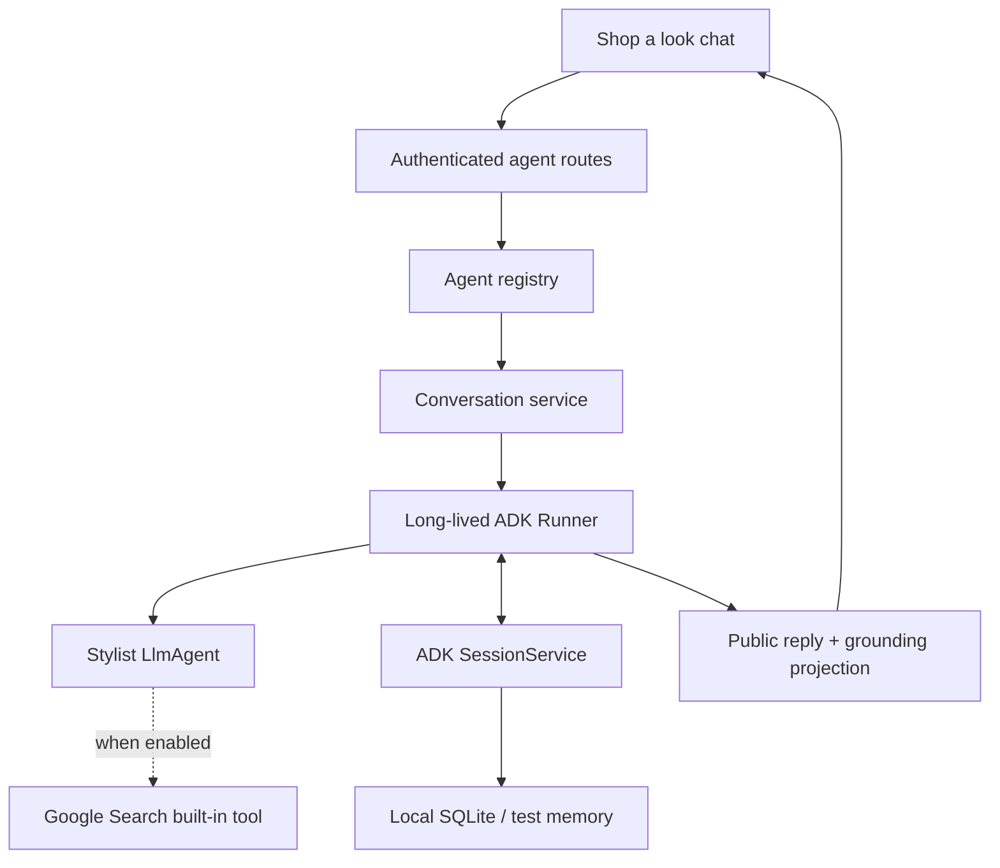

# Conversational agents

`/clothes` is now **Shop a look**: a text conversation with a Gemini stylist.
The original deterministic sample board remains at `/clothes/board` and is not
yet a tool the agent can edit. Reference-image input is a future extension.

## Enable and run

Keep the existing backend `.env` and set:

For Vertex AI, follow [local ADC setup](vertex-ai.md) and use its provider settings
instead of the API key below. The agent mode and search settings apply to both providers.

```dotenv
AGENT_MODE=demo
STYLIST_AGENT_MODE=gemini
STYLIST_SEARCH_ENABLED=false
GOOGLE_API_KEY=your-server-side-key
GEMINI_MODEL=gemini-flash-latest
AGENT_SESSION_BACKEND=sqlite
```

`STYLIST_AGENT_MODE` overrides the global mode for the chat agent only. Food and
the sample board can continue in demo mode. If the override is unset, the stylist
follows `AGENT_MODE`. There is no fake conversational response when it is disabled:
the UI shows that live chat is unavailable.

From `backend/`, run `uv sync --frozen --extra cloud`, then restart the API. From
`frontend/`, run `npm ci` and `npm run dev`. Use a model available to your API key.
Pin a concrete supported model ID before a release.
The latest alias is a development convenience, not a version guarantee.

Google Search is disabled by default. The stylist collects requirements and offers
outfit ideas and budget targets without browsing or claiming verified product
prices. The UI reads the agent's capabilities and hides the Google Search badge.
To enable search later, select a compatible model/project with grounding quota,
set `STYLIST_SEARCH_ENABLED=true` in `backend/.env`, and restart the backend.
The setting controls both the actual ADK tool list and the agent's instructions.

Try:

1. “I want an outfit for my sister's mehendi.”
2. Answer the stylist's budget and outfit-preference questions.
3. “My budget is INR 6000, shopping in India. A green kurta set for an outdoor daytime event. Suggest two outfit combinations.”
4. “Can you find something lighter and less embellished?”

The agent retains the earlier brief. When search is enabled, it can decide to use
Google Search and returns suggestions with the provider's grounding metadata. Search results
are evidence to inspect, not guaranteed price, inventory, or delivery data.

## Structure



| File | Responsibility |
| --- | --- |
| `backend/app/agents/base.py` | Immutable `AgentDefinition` and shared `LlmAgent` construction policy |
| `backend/app/agents/registry.py` | Agent factory, display name, enablement and allowed profile context |
| `backend/app/agents/stylist_agent.py` | Stylist definition, tools and style-only context |
| `backend/app/agents/prompts/stylist_conversation.md` | Actual clarification / planning / search instructions |
| `backend/app/agents/conversations.py` | Runner lifetime, sessions, turn limits, duplicate protection and errors |
| `backend/app/agents/grounding.py` | Public text, sources, citation-to-source mapping and search entry point |
| `backend/app/routers/agents.py` | Agent-neutral HTTP API; identity always comes from authentication |
| `frontend/src/pages/ShopLook.tsx` | Conversation creation, follow-up messages, recent chats and composer |
| `frontend/src/components/AgentMessage.tsx` | Markdown and grounded response display |

ADK already supplies `BaseAgent` and `LlmAgent`. We use composition instead of a
second base-agent inheritance hierarchy. The shared factory also constructs the
existing schema-constrained Food steps. The stylist has normal conversation
history and optional native Google Search, with no output schema forcing the reply into
product JSON. Its role is to orchestrate the conversation, not to simulate a
separate planner or execute purchases.

To add Food chat or another vertical, create its prompt/factory and register an
`AgentRegistration` with a suitable profile-context projection. The generic session
routes do not change. Each agent receives a separate ADK app namespace, preventing
accidental cross-agent history sharing. Only style preferences and country are
supplied to the stylist; saved allergies and dietary data stay out of its context.
For future specialist delegation, use ADK `sub_agents` for handoffs or `AgentTool`
when a coordinator should regain control. Keep native search/tool-combination
constraints and grounding propagation in mind when adding tools.

## Sessions, failures and boundaries

- A runner and agent are shared, while all user data lives in user-scoped ADK
  sessions. A new conversation gets a server-generated ID.
- Local SQLite at `backend/.data/agent_sessions.db` preserves chat across API
  restarts. It is ignored by Git and Docker. Firestore profiles/looks and ADK
  conversation events are different stores. `AGENT_SESSION_BACKEND=memory` is
  useful for tests and deliberately loses chat on restart.
- Authenticated users cannot read or send to another user's session. Demo auth
  still uses one shared local identity and must not be exposed as private service.
- A whole turn is protected against overlapping requests within one process.
  `request_id` is a client UUID: replaying a recorded request returns saved history
  without another Gemini call, including previously failed requests.
- Timeouts and provider failures preserve history and add a public error message.
  Send a new follow-up to retry a failed turn. The server never returns raw SDK
  errors, secrets or internal thoughts. It has a 40-turn conversation limit, six
  model calls per turn and a configurable timeout.
- Raw tool payloads and thought parts are excluded from the public transcript.
  Google Search's source URLs, support mappings and HTML/CSS search entry point
  are preserved. Markdown cannot execute raw HTML; the provider's search snippet
  is rendered in a sandboxed iframe with scripts and parent-origin access blocked.
- This initial implementation uses one API worker. SQLite is local storage, not
  durable Cloud Run storage. Before multi-instance deployment, provide a shared
  ADK session service (e.g. PostgreSQL/managed sessions), a distributed whole-turn
  lease, retention controls and session pagination. Database event locks alone do
  not serialize an entire model invocation.
- No SSE/token streaming yet. The UI shows a pending reply and then the final
  answer. Built-in Google Search does not necessarily emit ordinary function-call
  events, so the UI does not fabricate search progress.

## Endpoints

All routes below require the current user identity and start with `/api`:

| Method | Route | Result |
| --- | --- | --- |
| GET | `/agents` | Registered agents, enablement and current capabilities |
| POST | `/agents/stylist/sessions` | New empty conversation |
| GET | `/agents/stylist/sessions` | Current user's recent conversations |
| GET | `/agents/stylist/sessions/{id}` | Public conversation history |
| POST | `/agents/stylist/sessions/{id}/messages` | Send `{ "text": "...", "request_id": "UUID" }`; return updated history |

## Verification

`uv run pytest -q` exercises the actual ADK runner with a deterministic test LLM:
history, native search configuration, style-only context, grounding projection,
ownership, duplicate requests, failures, turn limits and SQLite restart persistence.
No normal test needs an API key or makes network calls.

An explicit live test is available separately:

```powershell
uv run python -m scripts.smoke_stylist
```

It makes two real Gemini turns and respects `STYLIST_SEARCH_ENABLED`. With search
enabled, it also checks that the second turn returns grounded source links. It uses
only a synthetic brief and an in-memory session. This can incur normal API costs.
It does not read saved profiles or modify real conversations.

## Troubleshooting Gemini 429 responses

To check just the key and a minimal text request, independently of ADK, sessions
and Google Search, run from `backend/`:

```powershell
uv run python scripts/check_google_key.py
# Authentication check only, without generating text:
uv run python scripts/check_google_key.py --auth-only
```

The script reads `GOOGLE_API_KEY` and `GEMINI_MODEL` from `backend/.env`. A process
environment variable overrides the file, just as in the backend. It reports model
listing and generation separately: listing can succeed while generation fails
with 429. The full check makes one small generation request and can incur normal
API costs. Exit code `0` means the requested checks passed; `1` means a failure.
Keys and raw provider errors are never printed.

Creating or reading a session does not call Gemini. A successful `201` for session
creation followed by `429` when sending a message means the provider rejected the
model request; starting another conversation does not replenish provider quota.

1. Open [AI Studio rate limits](https://aistudio.google.com/usage?tab=rate-limit)
   for the project associated with `GOOGLE_API_KEY`. Check the model selected by
   `GEMINI_MODEL` and the project's billing tier. Limits apply per project, so
   making another key within the same project does not add quota.
2. If the enforced limit is zero, review model availability and billing setup, or
   explicitly select a model with available quota that supports Google Search.
   Do not assume every model or `latest` alias has free-tier access.
3. If a daily allowance is exhausted, wait for its reset or review the project's
   quota. Gemini's requests-per-day limits reset at midnight Pacific time. For
   temporary throttling, wait at least the returned delay before a new follow-up.
4. After changing `backend/.env`, restart the backend. From `backend/`, run
   `uv run python -m scripts.diagnose_gemini` to make one small synthetic request
   using the configured search setting. Add `--search` to explicitly test Google
   Search before enabling it in the app. This uses the configured key/model and can incur
   normal API costs; it does not retry, read chat history, or change settings.

The API and saved transcript distinguish reported zero/daily quotas and temporary
retry delays. When supplied, a usable delay is also returned as `Retry-After`.
Server logs include a fixed reason code and delay, never the raw provider payload.
Some 429 responses contain no quota breakdown: `quota_unspecified` means the
project's AI Studio quota page is needed to distinguish quota from capacity.
No automatic model switching or additional application retry loop is used.

See [Gemini rate limits](https://ai.google.dev/gemini-api/docs/rate-limits) for
project scope, reset times and tier rules.

## ADK references used

- [ADK Google Search grounding](https://adk.dev/grounding/google_search_grounding/): native `google_search` on an `LlmAgent`.
- [ADK sessions](https://adk.dev/sessions/session/): runner/session separation, persistence and database concurrency.
- [ADK tool limitations](https://adk.dev/tools/limitations/): composition patterns when adding specialist tools.
- [ADK workflows](https://adk.dev/workflows/): later multi-agent orchestration options.
- [Google Search entry point](https://firebase.google.com/docs/reference/js/ai.searchentrypoint): preserving provider-supplied search presentation.
