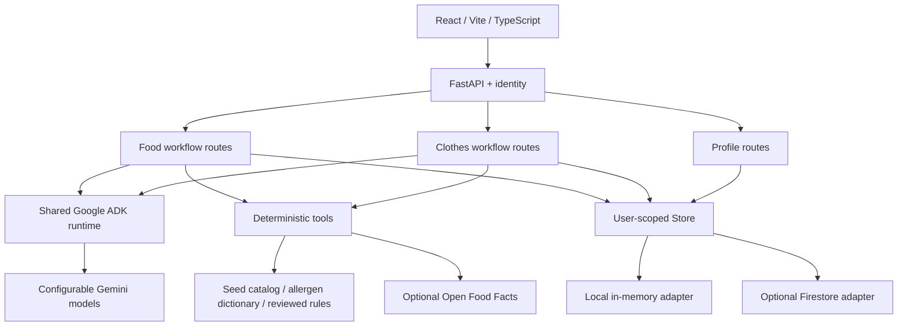

# Architecture and flow boundaries

The source plan's LangGraph interrupts are replaced by explicit API confirmation boundaries. Confirmation is a saved application state transition, independent of any model conversation. ADK does reading and explanation after prompts are implemented; ordinary Python controls business invariants. Do not give an agent authority to bypass a confirmation endpoint or write unchecked budget values.

Food: input → extraction → `awaiting_confirmation` → user edits / confirms → deterministic matches and source lookups → optional ADK summary → `reported` → follow-up against that report. Re-analysis is supported after another explicit confirmation. Photos are transient; no image history is stored.

Clothes: brief → optional ADK proposal → `awaiting_checklist` → user confirms categories → `shopping` → allocate / seed search → lock, swap, own, remove or reopen → `assembled` once all active categories are resolved. Swapping clears the selection, releases its amount, and recomputes open-category caps. An assembled look can be reopened through item actions.

The current API is request/response JSON. A future SSE adapter should emit typed progress labels and validated final data, never raw model thought events. Authentication must use fetch with a bearer token rather than placing tokens in an EventSource query string.

## Ownership and persistence

`users/{uid}` stores the profile. `users/{uid}/scans/{id}` and `users/{uid}/looks/{id}` store flow records. The uid comes only from the verified token (or the fixed local demo user), never a request body. API schemas reject extra fields.

Each ADK invocation uses a temporary `InMemorySessionService` session with explicit input context, cleaned up afterward. This is separate from durable business state. Implement persistent ADK sessions if multi-turn model memory is later required; do not put allergy profiles in global cross-user agent state.

The Firestore adapter demonstrates the intended storage boundary. Read-modify-write operations on looks currently require sequential requests; the UI serializes actions. Add Firestore transactions or revision-based optimistic concurrency before multiple clients edit the same look. Profile changes apply to the next analysis/agent invocation; existing reports remain snapshots.

## Evidence and deterministic behavior

- Money uses integer paise. Weighted largest-remainder allocation preserves the entire remaining budget, including rounding remainders.
- Only server-provided candidates can be locked. Owned and removed items cost zero.
- Allergen matching is deliberately a small keyword scaffold, not a complete medical classifier. Compounds, negations, ambiguous derivatives and languages need reviewed rules.
- The regulation JSON starts empty. Its eventual entries need `additive_id`, `country`, `status`, `condition`, `source_url`, and `reviewed_at`; non-unknown findings require a reviewed HTTPS source.
- The model only replaces the report summary; deterministic alerts are retained. The follow-up route allows citations only from verified report findings. These structural controls do not validate every claim in generated prose: content evaluation is still required before live use.
- Seed products are illustrative fixtures with no fabricated retailer URLs, ratings, delivery estimates or fetched times.

## API surface

| Method | Path under `/api` | Purpose |
| --- | --- | --- |
| GET | `/health` | Process status and active modes |
| GET / PUT | `/profile` | Load / save current user's profile |
| POST | `/food/extract` | Text or opt-in barcode lookup |
| POST | `/food/extract/photo` | Photo-to-ADK extraction seam |
| GET | `/food/scans` | Current user's scan history |
| GET | `/food/scans/{id}` | Resume scan or read report |
| POST | `/food/scans/{id}/analyze` | Explicit ingredient confirmation + analysis |
| POST | `/food/scans/{id}/ask` | Report follow-up seam |
| GET / POST | `/clothes/looks` | History / new brief |
| GET | `/clothes/looks/{id}` | Resume a look |
| POST | `/clothes/looks/{id}/checklist` | Confirm checklist once |
| POST | `/clothes/looks/{id}/items/{item_id}` | Lock / swap / own / remove / reopen |
| POST | `/clothes/looks/{id}/assemble` | Finalize a resolved look |

FastAPI publishes the complete request and response schema at `/openapi.json` and interactive examples at `/docs`.
