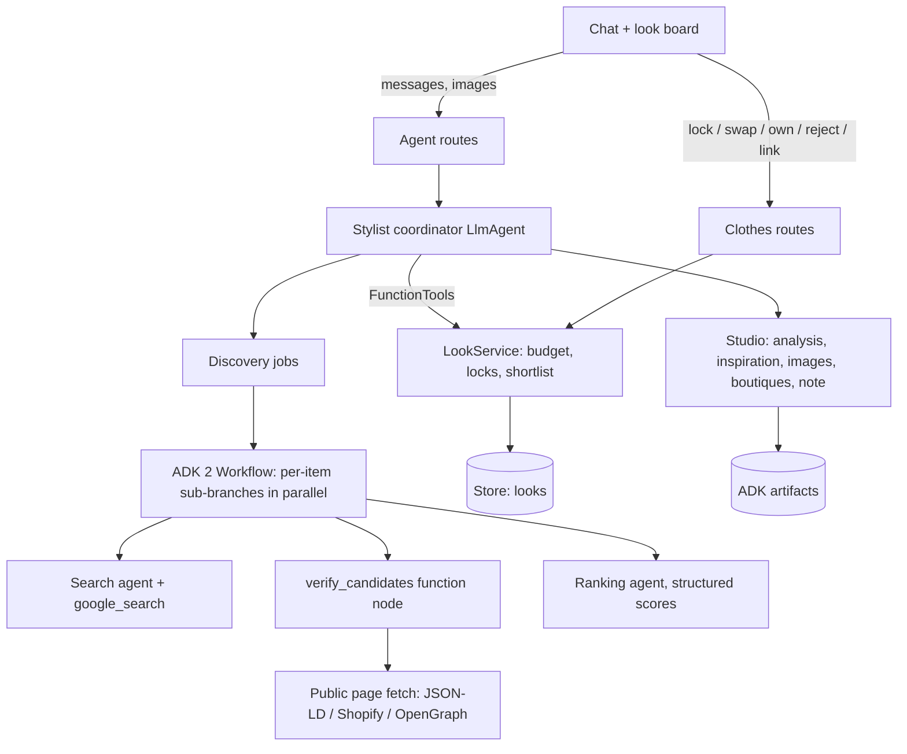

# Shop a Look

The stylist takes the user from an idea (an occasion, a description, or a
reference photo) to a complete, priced look built from real products, one item at
a time. The chat and a live **look board** share one state; the board is the
source of truth for the brief, checklist, candidates, prices and budget.

## The six steps

| Step | What happens | Where |
| --- | --- | --- |
| 1. Describe / upload | Text and/or up to 3 reference images (JPEG/PNG/WebP, 5 MB). `analyze_reference` turns them into pieces, palette and style tags (images sent at high media resolution) | Composer attach button → ADK artifact |
| 1b. Ideas (vague request, no image) | Mira asks one or two taste questions per turn (role, vibe, colours, comfort, budget) with tappable quick replies, saves the occasion right away (the look is `exploring` until a budget is set), offers `find_inspiration`, and `use_inspiration(n)` turns a numbered idea into the reference image | Chat + board |
| 2. Preferences | `save_brief`: occasion (required), budget (required before a checklist), date, sizes, colours, colours to avoid, shops, delivery city/PIN, retailer policy | Chat |
| 3. Checklist | `propose_checklist` drafts items with searchable targets; user marks owned / removes / adds; confirm on the board or approve in chat (`start_shopping`) | Board + chat |
| 4. Discover | Background ADK workflow searches, verifies product pages and ranks per item; board shows progress | Board |
| 5. Finalise | Lock from a card or in chat (`select_product`); remaining items are re-ranked to match. Like / not-for-me (with a reason) on each card, or in chat via `give_feedback`; *Find more using your feedback* searches again with it. "Cheaper / matching" → `find_alternatives`. Paste a link → `add_product_link` | Board + chat |
| 6. Review | `finish_look` / *Finish my look*: products, prices, total, remaining budget, store links, styling note. Swap any single item later | Board |

Imagination features run alongside: `find_inspiration` (numbered ideas with
images: Pinterest pins via Pinterest's public oEmbed, plus editorial and store
pages) and `visualize_look` (AI concept, edit of the user's reference photo, or a
composition of the selected products), always labelled as AI concepts.

Quick replies: when the stylist ends a question with
`Quick replies: A | B | C`, `grounding.split_quick_replies` strips that line into
`ChatMessage.suggestions`, rendered as chips that send the reply.

## Architecture



| File | Responsibility |
| --- | --- |
| `app/agents/stylist_agent.py` | Coordinator: prompt, tools, per-turn context (live board snapshot, attachments, capabilities) |
| `app/clothes/tools.py` | Coordinator tools; identity and look id come from `ToolContext`, never model arguments |
| `app/clothes/service.py` | `LookService`: every state transition, budget allocation, deterministic shortlist, per-look locking |
| `app/clothes/discovery.py` | Discovery jobs and the `look_discovery` ADK 2 workflow |
| `app/clothes/pages.py` | SSRF-guarded public fetch; product facts from structured data only |
| `app/clothes/sellers.py` | Seller labels from `data/sellers.json` and `data/small_businesses.json` |
| `app/clothes/studio.py` | Reference analysis, inspiration, concept images, Maps boutiques, styling note |
| `app/agents/privacy.py` | Redacts provider payloads from ADK 2 logs and persisted error events |
| `frontend/src/components/LookPanel.tsx` | The look board |

## Facts are verified, not generated

Search only **nominates** URLs. Each candidate page is fetched (public https
hosts only, every redirect hop re-checked) and its own structured data is read:
schema.org Product JSON-LD, then Shopify's `/products/<handle>.js`, then
OpenGraph product tags, then schema.org microdata, and on amazon.in only,
Amazon's own price markup (`page_html`). A page without a title and an INR price
is dropped. A **listing page** (collection/category) is not dropped: up to 4
product links from its schema.org ItemList (or Shopify / Flipkart / Amazon URL
shapes, same host only) are verified in its place, for at most 3 listings per
pass. Ratings and stock appear only when the page publishes them. Delivery dates
are never promised.

**Search pass, then a broader pass.** The search agent answers with a Markdown
link list, not JSON: Gemini attaches grounding sources (the URLs search actually
returned) only to prose answers, and drops `site:`/`OR` operators, so the prompt
names stores in plain queries. If fewer than 6 products verify, one broader pass
runs (synonyms, other stores, skipping what was found). In a live check on
Vertex (`gemini-3.6-flash`), jhumkas went from 5 verified products (all
independent, with a third of the model-written URLs 404s) to 11 (6 Myntra /
Flipkart, 5 independent).

**Search results survive board edits.** A search job's results belong to the
newest job for that item (`Discovery._owners`), not to the plan revision, so
selecting, removing or rejecting something elsewhere no longer throws finished
searches away and restarts them.

The shortlist is deterministic: up to 6 products within the item's budget cap,
not rejected, not out of stock, fit score ≥ 35 (clear mismatches such as bulk
gift packs are hidden). Liked products lead. Popular-first keeps one slot, and
balanced two, for an independent store when one qualifies. If fewer than 6 fit
the cap, up to 2 products with fit ≥ 60 that still fit the remaining total budget
are added as **stretch** picks, labelled on the card. Only server-provided
candidates can be locked. User-added links keep a page price, or a user-entered
price shown as such.

**Feedback.** `ChecklistItem.feedback` stores up to 24 likes/dislikes with
reasons and a note. A dislike hides the product; a like pins it and keeps it in
the pool across new searches. Every later search and ranking for the item gets
the liked/disliked examples.

## Small businesses

| Label | Rule |
| --- | --- |
| Verified small business | Domain is in `data/small_businesses.json` with a source and review date (ships empty; curate it) |
| Independent store | Own-domain store not in the marketplace/brand lists |
| Marketplace / Brand | Domain lists in `data/sellers.json` |

Every search mixes popular-store queries (Myntra, Amazon, Flipkart, Ajio, Nykaa
Fashion) with independent-label queries (handmade, handloom, artisan, homegrown,
craft names), roughly two to one. "Independent only" keeps own-domain stores
(reviewed small businesses first) and drops marketplaces. Marketplace cards
show the store first, e.g. "Myntra · Soch". With `STYLIST_MAPS_ENABLED=true`,
`find_local_boutiques` lists Google Maps places near the delivery city (checked
live on Vertex: real places with Maps links).

## Configuration

```dotenv
GEMINI_MODEL=gemini-3.6-flash          # gemini-3.5-flash is deprecated and routed here
GEMINI_LITE_MODEL=gemini-3.5-flash-lite # ranking; separate per-minute quota from chat
STYLIST_AGENT_MODE=gemini
STYLIST_SEARCH_ENABLED=true        # discovery + inspiration
STYLIST_IMAGES_ENABLED=true        # concept images / reference edits
GEMINI_IMAGE_MODEL=gemini-3.1-flash-image
STYLIST_MAPS_ENABLED=true          # verified working on Vertex AI
ARTIFACT_BACKEND=file              # backend/.data/artifacts; gcs + ARTIFACT_BUCKET on Cloud Run
```

Limits: a chat turn has `STYLIST_TIMEOUT_SECONDS` (120) and `STYLIST_MAX_LLM_CALLS`
(12). Discovery runs outside the turn, with `DISCOVERY_TIMEOUT_SECONDS` (180),
at most 3 items searching at once, and low thinking so each search agent runs a
few queries. Stylist and background agents retry 429/503 with backoff (Food is
unchanged).

**Quota.** Discovery uses Google Search grounding for every item and shares the
project's per-minute Gemini quota with chat. On a low quota tier a chat turn can
still return 429 while searches run; the board keeps whatever tools already
changed. Check Vertex AI quotas before a demo.

**Windows.** ADK's `FileArtifactService` nests directories deeply. Keep
`ARTIFACT_DIR` short (the default under `backend/.data` is fine); a long path
exceeds the 260-character limit and uploads fail with a 503.

## Endpoints (under `/api`)

| Method | Route | Purpose |
| --- | --- | --- |
| POST | `/agents/stylist/sessions/{id}/attachments` | Upload a reference image (multipart `image`) |
| GET | `/agents/stylist/sessions/{id}/artifacts/{name}` | Read an upload or concept image (owner only) |
| POST | `/agents/stylist/sessions/{id}/messages` | `{text, request_id, attachments[]}`; reply includes `look_id` |
| GET | `/clothes/looks/{id}` | The look board |
| POST | `/clothes/looks/{id}/checklist` | Confirm the checklist (starts discovery) |
| POST | `/clothes/looks/{id}/items` | Add a piece |
| POST | `/clothes/looks/{id}/items/{item}` | `lock`, `swap`, `own`, `remove`, `reopen`, `reject` |
| POST | `/clothes/looks/{id}/items/{item}/alternatives` | Search again with a request / price ceiling |
| POST | `/clothes/looks/{id}/items/{item}/link` | Add a product link (optional user price) |
| POST | `/clothes/looks/{id}/items/{item}/feedback` | `{product_id, sentiment: like\|dislike, reasons[], note}` |
| POST | `/clothes/looks/{id}/discover` | Retry discovery for open items |
| POST | `/clothes/looks/{id}/assemble` | Finish the look with a styling note |

## Verification

`uv run pytest -q` covers page parsing and SSRF rules, seller labels, the
shortlist, budget with custom items, the discovery workflow end to end with a
scripted model (parallel items, a hallucinated URL, a grounding redirect, an
isolated failure, re-ranking after a lock), search-job ownership races, the
coordinator's tools through the HTTP API, attachment validation and ownership,
and redaction of provider errors.

Live, opt-in (incurs API cost):

```powershell
uv run python -m scripts.smoke_shop_look            # chat → checklist → discovery
uv run python -m scripts.smoke_shop_look --images   # also a concept image
```

## Known limits

- Myntra and Flipkart product pages verify (JSON-LD), and Amazon.in does through
  its price markup. Ajio, Nykaa Fashion and Meesho block or script their pages
  (403 / bot checks), so their listings are usually dropped. Independent
  Shopify/WooCommerce stores verify well.
- Following a listing page means fetching a store's collection page that Google
  returned. Respect each store's terms; for production, prefer official
  affiliate/product APIs where a store offers one.
- Pinterest has no public search API, and Google Search grounding rarely returns
  pins, so most ideas are editorial or store pages. Pin images come from
  Pinterest's public oEmbed endpoint.
- Looks live in the configured Store; chat sessions and artifacts follow the
  existing single-worker/local-storage limits described in [agents.md](agents.md).
- The phone layout (tabbed chat/board below 1100px) has not been checked on a
  real device.
