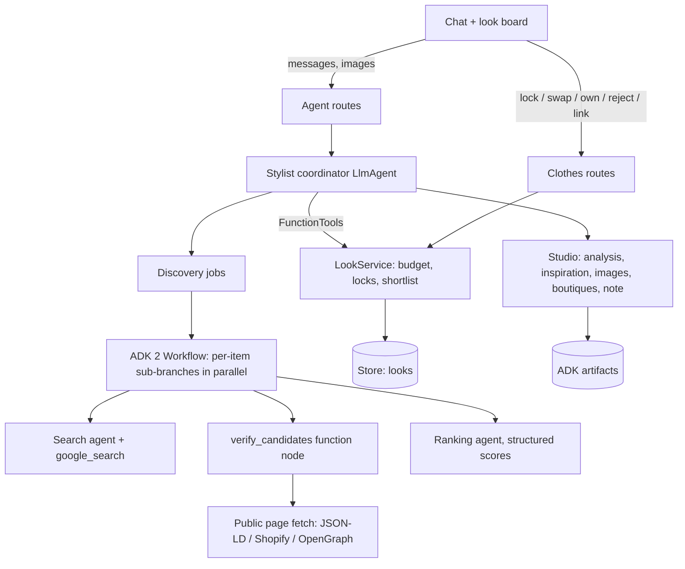

# Shop a Look

The stylist takes the user from an idea (an occasion, a description, or a
reference photo) to a complete, priced look built from real products, one item at
a time. The chat and a live **look board** share one state; the board is the
source of truth for the brief, checklist, candidates, prices and budget.

## The six steps

| Step | What happens | Where |
| --- | --- | --- |
| 1. Describe / upload | Text and/or up to 3 reference images (JPEG/PNG/WebP, 5 MB). `analyze_reference` turns them into pieces, palette and style tags | Composer attach button → ADK artifact |
| 2. Preferences | `save_brief`: occasion, budget (required), date, sizes, colours, colours to avoid, shops, delivery city/PIN, small-business preference | Chat |
| 3. Checklist | `propose_checklist` drafts items with searchable targets; user marks owned / removes / adds; confirm on the board or approve in chat (`start_shopping`) | Board + chat |
| 4. Discover | Background ADK workflow searches, verifies product pages and ranks per item; board shows progress | Board |
| 5. Finalise | Lock from a card or in chat (`select_product`); remaining items are re-ranked to match. "Cheaper / matching" → `find_alternatives`. Paste a link → `add_product_link` | Board + chat |
| 6. Review | `finish_look` / *Finish my look*: products, prices, total, remaining budget, store links, styling note. Swap any single item later | Board |

Imagination features run alongside: `find_inspiration` (Pinterest pins via the
official Pin widget, plus editorial pages) and `visualize_look` (AI concept,
edit of the user's reference photo, or a composition of the selected products),
always labelled as AI concepts.

## Architecture



| File | Responsibility |
| --- | --- |
| `app/agents/stylist_agent.py` | Coordinator: prompt, tools, per-turn context (live board snapshot, attachments, capabilities) |
| `app/clothes/tools.py` | Coordinator tools; identity and look id come from `ToolContext`, never model arguments |
| `app/clothes/service.py` | `LookService`: every state transition, budget allocation, deterministic shortlist, per-look locking |
| `app/clothes/discovery.py` | Discovery jobs and the `look_discovery` ADK 2 workflow |
| `app/clothes/pages.py` | SSRF-guarded public fetch; product facts from structured data only |
| `app/clothes/sellers.py` | Seller labels from `data/sellers.json` and `data/small_businesses.json` |
| `app/clothes/studio.py` | Reference analysis, inspiration, concept images, Maps boutiques, styling note |
| `app/agents/privacy.py` | Redacts provider payloads from ADK 2 logs and persisted error events |
| `frontend/src/components/LookPanel.tsx` | The look board |

## Facts are verified, not generated

Search only **nominates** URLs. Each candidate page is fetched (public https
hosts only, every redirect hop re-checked) and its own structured data is read:
schema.org Product JSON-LD, then Shopify's `/products/<handle>.js`, then
OpenGraph product tags. A page without a title and an INR price is dropped. In
live testing, model-cited URLs included pages that did not exist (404s) and pages
with no readable price; neither reaches the board. Ratings and stock appear only when the page publishes them.
Delivery dates are never promised.

The shortlist is deterministic: within the item's budget cap, not rejected, not
out of stock, fit score ≥ 35 (clear mismatches such as bulk gift packs are hidden),
sorted by fit with a small-business boost, and one slot reserved for an
independent seller when one qualifies. Only server-provided candidates can be
locked. User-added links keep a page price, or a user-entered price shown as such.

## Small businesses

| Label | Rule |
| --- | --- |
| Verified small business | Domain is in `data/small_businesses.json` with a source and review date (ships empty; curate it) |
| Independent store | Own-domain store not in the marketplace/brand lists |
| Marketplace / Brand | Domain lists in `data/sellers.json` |

Search adds independent-seller queries (handmade, handloom, artisan, homegrown,
craft names) unless the preference is "off"; "only" restricts the shortlist.
With `STYLIST_MAPS_ENABLED=true`, `find_local_boutiques` lists Google Maps places
near the delivery city.

## Configuration

```dotenv
STYLIST_AGENT_MODE=gemini
STYLIST_SEARCH_ENABLED=true        # discovery + inspiration
STYLIST_IMAGES_ENABLED=true        # concept images / reference edits
GEMINI_IMAGE_MODEL=gemini-3.1-flash-image
STYLIST_MAPS_ENABLED=true          # verified working on Vertex AI
ARTIFACT_BACKEND=file              # backend/.data/artifacts; gcs + ARTIFACT_BUCKET on Cloud Run
```

Limits: a chat turn has `STYLIST_TIMEOUT_SECONDS` (120) and `STYLIST_MAX_LLM_CALLS`
(12). Discovery runs outside the turn, with `DISCOVERY_TIMEOUT_SECONDS` (180),
at most 3 items searching at once, and low thinking so each search agent runs a
few queries. Stylist and background agents retry 429/503 with backoff (Food is
unchanged).

**Quota.** Discovery uses Google Search grounding for every item and shares the
project's per-minute Gemini quota with chat. On a low quota tier a chat turn can
still return 429 while searches run; the board keeps whatever tools already
changed. Check Vertex AI quotas before a demo.

**Windows.** ADK's `FileArtifactService` nests directories deeply. Keep
`ARTIFACT_DIR` short (the default under `backend/.data` is fine); a long path
exceeds the 260-character limit and uploads fail with a 503.

## Endpoints (under `/api`)

| Method | Route | Purpose |
| --- | --- | --- |
| POST | `/agents/stylist/sessions/{id}/attachments` | Upload a reference image (multipart `image`) |
| GET | `/agents/stylist/sessions/{id}/artifacts/{name}` | Read an upload or concept image (owner only) |
| POST | `/agents/stylist/sessions/{id}/messages` | `{text, request_id, attachments[]}`; reply includes `look_id` |
| GET | `/clothes/looks/{id}` | The look board |
| POST | `/clothes/looks/{id}/checklist` | Confirm the checklist (starts discovery) |
| POST | `/clothes/looks/{id}/items` | Add a piece |
| POST | `/clothes/looks/{id}/items/{item}` | `lock`, `swap`, `own`, `remove`, `reopen`, `reject` |
| POST | `/clothes/looks/{id}/items/{item}/alternatives` | Search again with a request / price ceiling |
| POST | `/clothes/looks/{id}/items/{item}/link` | Add a product link (optional user price) |
| POST | `/clothes/looks/{id}/discover` | Retry discovery for open items |
| POST | `/clothes/looks/{id}/assemble` | Finish the look with a styling note |

## Verification

`uv run pytest -q` covers page parsing and SSRF rules, seller labels, the
shortlist, budget with custom items, the discovery workflow end to end with a
scripted model (parallel items, a hallucinated URL, a grounding redirect, an
isolated failure, re-ranking after a lock), search-job ownership races, the
coordinator's tools through the HTTP API, attachment validation and ownership,
and redaction of provider errors.

Live, opt-in (incurs API cost):

```powershell
uv run python -m scripts.smoke_shop_look            # chat → checklist → discovery
uv run python -m scripts.smoke_shop_look --images   # also a concept image
```

## Known limits

- Large marketplaces often block page checks or render prices with JavaScript, so
  their listings may be dropped; independent Shopify/WooCommerce stores usually
  verify well.
- Pinterest has no public search API; pins come from Google results and render
  with Pinterest's widget (some may fail to embed and show as links).
- Looks live in the configured Store; chat sessions and artifacts follow the
  existing single-worker/local-storage limits described in [agents.md](agents.md).
- The phone layout (tabbed chat/board below 1100px) has not been checked on a
  real device.
