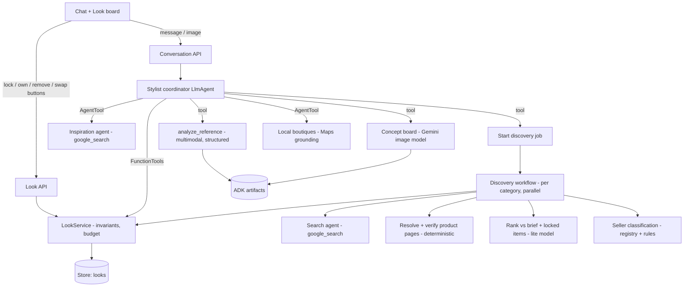

# Shop a Look — stylist agent plan

Status: implemented on branch `feature/stylist-agent` (2026-10-18); see
[shop-a-look.md](shop-a-look.md) for the as-built design. Decisions taken: ADK
upgraded to 2.12; discovery starts automatically on checklist confirmation; the
small-business registry ships empty; Vertex AI is the provider. Deviation: the
coordinator has no raw `google_search` tool, so store prices only reach chat
through the verified board.

## Goal

One conversation takes the user from an idea ("recreate this Mehendi look with
cheaper accessories") to a complete, priced, linkable look:

1. Describe or upload the look
2. Preferences and budget
3. Shopping checklist (add / remove / already own)
4. Discover matching products (incl. small businesses)
5. Finalise one item at a time; recommendations re-anchor to what's locked
6. Review the full look; swap any single item without rebuilding

Two differentiators:

- **Imagination:** inspiration from Pinterest and the web, and AI-generated
  concept boards so the user can see the look before shopping for it.
- **Small businesses:** discovery deliberately surfaces independent labels,
  artisans and local boutiques, labelled honestly.

## Design principles (carried over)

- **The model proposes; code decides.** Prices, budgets, locks and totals are
  computed by Python from verified data. The agent changes the look only through
  tools that enforce the same invariants as the board endpoints.
- **No invented commerce facts.** Price, stock, rating and delivery come from a
  fetched product page, or they are shown as unknown.
- **Chat + board are one state.** The look record in `Store` is the source of
  truth; chat and UI buttons both mutate it through the same service layer.

## Google ADK: what we use and why

ADK Python 2.0 went GA on 2026-05-19 (2.6 by late July). The repo pins
`google-adk 1.35.2`. Capabilities mapped to this flow:

| ADK capability | Used for | Notes |
| --- | --- | --- |
| `LlmAgent` coordinator, persistent sessions | The stylist conversation (exists) | Keep `DatabaseSessionService`/SQLite locally |
| `FunctionTool` | Look-board mutations, product verification, budget | Deterministic; reads `uid`/`look_id` from `ToolContext`, never from model args |
| `AgentTool` | Wrap built-in-tool specialists (search, maps) so the coordinator keeps control | Same pattern as `food_agent.py`; avoids the built-in-tool mixing limit |
| `google_search` (built-in) | Product, inspiration and small-business discovery | Grounding URIs are redirect links, so we resolve and verify them (below) |
| `GoogleMapsGroundingTool` (built-in) | Local boutiques / tailors near the delivery city | Useful when the event date is too close for delivery |
| `url_context` (built-in) | Fallback extraction when a product page has no structured data | Isolated in its own agent |
| Multimodal input + **Artifacts** | Reference-image upload, generated concept boards | `InMemoryArtifactService` locally, `GcsArtifactService` on Cloud Run |
| `output_schema` agents | Reference analysis, checklist proposal, candidate ranking | Existing `build_agent` factory |
| **2.x dynamic workflow** (`@node`, `ctx.run_node`, `asyncio.gather`) | Per-category parallel discovery pipeline | Code-driven fan-out; `RetryConfig` for flaky fetches |
| Callbacks / plugins | Guardrails (strip unverified prices), logging, the Reflect-and-Retry plugin for schema failures | |
| ADK eval (trajectory + rubric) | "Doesn't search before budget", "locks via tool", "never quotes unverified price" | |

**Decision: upgrade to ADK 2.x, behind a spike (Phase 0).** The discovery
pipeline benefits directly from 2.x dynamic workflows. The outer 6-step flow
does **not** become a rigid graph: users jump between steps (swap at review,
add an item mid-shopping). A conversational coordinator plus the existing
`Look` state machine fits that better. Graphs are used where the work really is a
pipeline. Fallback if the spike fails: stay on 1.x and run the same pipeline as
plain async Python calling agents through `AgentRuntime` (as `food_pipeline.py`
does). The tools and UI are identical either way.

Things the spike must verify against the installed version (APIs were read from
docs, not run yet):

- `Workflow` / `@node` / `ctx.run_node` import paths and running a workflow from a tool.
- `GoogleMapsGroundingTool` availability on our provider (Developer API vs Vertex).
- `conversations.py:record_failure` appends events directly. 2.x says not to do
  this *inside nodes*; confirm it is still safe from the service layer.
- Existing food tests and the deterministic test LLM still pass.

## Architecture



### Coordinator tools

| Tool | Kind | Behaviour |
| --- | --- | --- |
| `save_brief(...)` | Function | Upserts the brief (occasion, budget, sizes, colours, avoid, platforms, delivery city/PIN, event date, small-business preference). Creates the look if none. |
| `analyze_reference()` | Function to structured agent | Reads the uploaded image artifact and returns `LookAnalysis`: pieces, colours, fabric, embellishment, silhouette, formality and a per-category description. |
| `propose_checklist(items)` | Function | Writes a draft checklist (`awaiting_checklist`). The UI renders it for confirmation; the agent cannot confirm on the user's behalf. |
| `update_checklist(category, action)` | Function | add / remove / own, including custom items ("dupatta"). |
| `find_inspiration(query)` | AgentTool | Pinterest pins and editorial images (see Imagination). |
| `visualize_look(instructions)` | Function | Generates or edits a concept board, saves it as an artifact. |
| `discover_products(categories?, hints?)` | Function | Starts a background discovery job; returns immediately. |
| `request_alternatives(category, hint)` | Function | e.g. "cheaper", "more silver", "match the lehenga". Excludes rejected ids. |
| `lock_product(item_id, product_id)` | Function | Only server candidates; budget checked; triggers re-ranking of open items. |
| `swap_item(item_id)` | Function | Unlock, release budget, refresh that one category. |
| `find_local_boutiques(category)` | AgentTool | Maps-grounded boutiques near the delivery city. |
| `get_look()` | Function | Current board snapshot. A short summary is also injected into the instruction each turn. |

The coordinator prompt (`stylist_conversation.md`) is rewritten around these
steps. Every capability statement stays truthful to which tools are enabled, as
today.

## Step-by-step behaviour

**1. Describe / upload.** Text, image, or both. The image goes through the
existing photo validation (MIME, size, decoded content), is stored as a session
artifact and is attached to the turn. `analyze_reference` produces the
`LookAnalysis`. Modifiers in the text ("cheaper accessories", "less heavy")
become `hints` on specific checklist items.

**2. Preferences.** The agent asks at most two questions per turn. Only budget,
currency and country are required; everything else is optional, with profile
defaults. A compact "Preferences" card on the board lets users edit these without
chatting.

**3. Checklist.** Proposed from the analysis and occasion (Mehendi: outfit,
earrings, necklace, bangles, footwear, handbag, optional hair accessories). Each
item carries a target description ("emerald georgette lehenga, mirror work"). The
user confirms on the board. Budget caps come from the existing largest-remainder
allocator, extended with a default weight for custom categories. "Make
accessories affordable" shifts weight toward the outfit.

**4. Discovery** (background job per look):

```text
for each open item, in parallel (ctx.run_node + asyncio.gather):
  queries   = search agent(brief, item target, platforms, small-business variants)
  urls      = resolve grounding redirects, dedupe, drop non-product pages
  products  = verify each URL (bounded concurrency, timeout, SSRF guard from web_fetch.py):
                parse schema.org Product JSON-LD / OpenGraph product tags
                -> title, price, currency, image, availability, aggregateRating, seller
                fallback: url_context extraction agent, marked lower confidence
  products  = drop price > item cap (deterministic), drop wrong currency
  ranked    = lite ranking agent(brief, analysis, LOCKED items) -> style score + reason
  shortlist = top 4, guaranteeing a small-business slot when one qualifies
  write candidates + progress to the look
```

Progress is stored per item (`searching`, `verifying`, `ready`, `no_results`), and
the board polls the look. This keeps chat turns within the current 60 s and
6-LLM-call limits. Discovery runs outside the chat turn with its own limits.

**5. Finalise.** Lock from a card or in chat ("I like this lehenga"). After a
lock, open items are re-ranked against the locked piece's colour and formality
(cheap re-rank first, re-search only if the shortlist runs thin). "Cheaper
earrings that match it" calls `request_alternatives` with a lower price ceiling
and the lehenga as anchor. Rejected products are remembered per item.

**6. Review.** The existing assembled view, extended with product images,
retailer links, a small-business badge, "price checked at <time>", the total,
the remaining budget and an event-date delivery warning. **Swap** reopens one
item and runs discovery for that category only. A final styling note
(`stylist_note.md`) and an optional concept board of the chosen pieces complete
the review.

## Imagination: inspiration and concept boards

- **Pinterest.** Pinterest offers no self-serve search API (v5 search is
  partner/beta only). Plan: the inspiration agent runs `google_search` with
  `site:pinterest.com` and occasion/style terms to find pin URLs. We display them
  with Pinterest's official **Pin embed widget** (`data-pin-do="embedPin"`),
  which needs no app approval. No scraping of Pinterest images.
- **Web inspiration.** Editorial and designer pages from the same search. Show the
  page's `og:image` with a link back, captioned as inspiration, not a product.
- **Concept boards.** A Gemini image model (`gemini-3.1-flash-image`, "Nano
  Banana 2", GA May 2026; new `GEMINI_IMAGE_MODEL` setting) generates:
  - a flat-lay or moodboard from the brief before shopping ("see the idea"),
  - an edit of the user's reference ("same look, silver jhumkas instead of gold"),
  - a final board composed from the locked products' images.
  Always labelled "AI concept, not a real product". The model's built-in Image
  Search grounding is reported flaky, so we don't depend on it.
- Not using: the Google Custom Search JSON API (closed to new customers, shuts
  down 2027-01-01). Vertex Virtual Try-On is preview and Vertex-only, so it stays
  a stretch add-on.

## Small businesses

Honest labelling matters more than volume. Each product's seller gets one of:

| Label | How it's determined |
| --- | --- |
| **Verified small business** | Domain is in a curated `data/small_businesses.json` (name, domain, city, what they make, source, `reviewed_at`), same discipline as `regulations.json` |
| **Independent store** | Own-domain store, not in the marketplace/large-brand lists (deterministic rules in `data/sellers.json`) |
| Marketplace / Brand | Known large marketplaces and brands |
| Unknown | Anything else; no badge |

Discovery strategy:

- Per category, run extra query variants: handmade, handloom, artisan,
  homegrown label, Indian craft names relevant to the item (e.g. block print,
  kundan, kolhapuri).
- Search the registry's domains first (`site:` queries) when the preference is
  "prefer" or "only".
- Instagram-only boutiques can't be price-verified. Show them in a separate
  "Boutiques to DM" strip with a link, not as lockable candidates, unless the user
  adds a price manually (below).
- `find_local_boutiques` uses Maps grounding to list nearby shops for
  try-on or last-minute buys, with Maps attribution.
- Ranking gives a configurable boost to small businesses. When one fits the
  budget, at least one shortlist slot is reserved for it.

**User-added products.** The user pastes any link, we run the same verifier, and
if no price is found they enter the price they see. It is stored as
`price_source="user"` and shown that way. This also covers Instagram sellers.

## Data model changes (`app/schemas.py`)

- `LookBrief`: `sizes`, `colours`, `avoid_colours`, `platforms`,
  `delivery_city`, `delivery_pin`, `event_date`, `small_business:
  off|prefer|only`, `reference_artifacts`, `analysis: LookAnalysis | None`.
- `Category`: keep the 7 known values plus custom labels (validated string,
  max 7 to 10 items). `WEIGHTS` gets a default for custom items.
- `ChecklistItem`: `target` description, `hints`, `rejected_ids`,
  `discovery_status`, `local_boutiques`.
- `CatalogProduct`: `source: live|seed|user`, `price_source`, `price_fetched_at`
  (exists), `availability`, `rating`/`rating_count` (only from structured data),
  `seller_name`, `seller_label`, `style_score`, `match_reason`, `image_url`.
  `delivery_estimate` only when the page states it.
- `Look`: `session_id`, `inspiration: list[InspirationItem]`, `concepts:
  list[artifact ref]`, `revision` (optimistic concurrency, since chat and board
  can now write the same look).

`LookService` takes the invariant logic out of `routers/clothes.py` so the API
endpoints and agent tools share it.

## UI

- `/clothes` becomes a split view: chat on the left, live Look board on the right
  (on mobile: a "Board" tab with a badge count).
- Board sections: Inspiration strip (pins, generated concepts), Preferences card,
  Checklist (confirm, add, own, remove), Category carousels (product card: image,
  price, retailer, seller badge, rating if verified, *Lock / More like this /
  Cheaper*), Summary.
- Composer gets image attach (re-use food photo picker), and messages render
  thumbnails.
- Board actions call the Look API. The next chat turn sees the change through the
  injected look snapshot, so the agent never acts on a stale board.

## Delivery phases

Each phase ends demoable.

| Phase | Scope | Done when |
| --- | --- | --- |
| **0. Spike** (½ day) | ADK 2.x upgrade on a branch; verify APIs listed above; remove the debug-log block in `conversations.py` that writes to an absolute path | All existing tests pass on 2.x, or the 1.x fallback is chosen |
| **1. Brief → checklist** | Schemas, `LookService`, image upload + artifacts, `analyze_reference`, `save_brief`/`propose_checklist`/`update_checklist`, split-view board | Mehendi photo + "cheaper accessories" → editable checklist with targets and caps |
| **2. Imagination** | Inspiration agent + Pin embeds, concept board generate/edit | Pins and an AI concept board on the board before shopping |
| **3. Discovery** | Search agent, redirect resolution, structured-data verifier, seller classification + registry seed, ranking, background job + progress | Each category shows 2 to 4 verified, priced, linked candidates; small-business slot when available |
| **4. Finalise + review** | Lock/alternatives/swap tools, re-rank on lock, user-added products, local boutiques, review page + styling note + final concept | "Lock this lehenga, find cheaper matching earrings" works end to end; swap one item at review |
| **5. Hardening** | ADK evals, prompt-injection cases from product pages, docs, smoke script | Evals pass; README/agents.md updated |

## Testing

- Unit: verifier against saved HTML fixtures (JSON-LD, OG-only, no data, wrong
  currency, blocked), seller classification, budget with custom categories,
  lock/swap invariants via `LookService`.
- ADK runner tests with the deterministic test LLM (as existing): the tool call
  sequence for each step and that no tool accepts a model-supplied price.
- ADK eval set (live, opt-in): no search before budget is known, no unverified
  prices in prose, small-business labels match the data, honest when search is
  disabled.
- No test makes network calls by default; live smoke scripts stay opt-in.

## Risks and limits to state in the demo

- Large Indian fashion marketplaces are heavily JS-rendered or bot-protected.
  Their pages may fail verification and then appear as unverified links, not
  lockable products. Independent Shopify/WooCommerce stores usually expose
  JSON-LD, which helps the small-business goal.
- Delivery estimates are rarely machine-readable. We warn using event date vs
  "check delivery to PIN", never a promised date.
- Search grounding quota and cost: discovery is about 1 search + 1 ranking call
  per category, plus fetches. Cap categories and candidates, and cache verified
  pages briefly (reuse the food evidence cache pattern).
- Generated images can look like real products. They are always labelled and
  never lockable.

## Open decisions

1. ADK 2.x upgrade vs stay on 1.x (recommendation: upgrade, gated by Phase 0).
2. Provider for the demo: Vertex AI (needed for GCS artifacts and possibly Maps
   grounding) vs Gemini Developer API.
3. Initial small-business registry: who curates the first 20 to 30 entries and for
   which categories/cities.
4. Whether discovery runs automatically after checklist confirmation or waits for
   the user's "start shopping".
